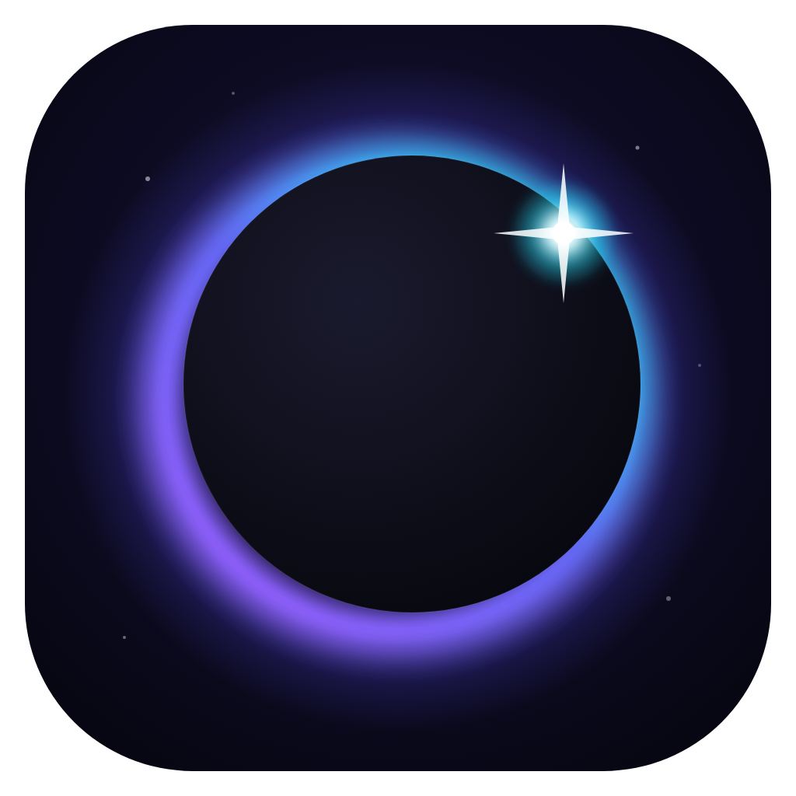

<p align="center"></p>

<h1 align="center">Umbra</h1>
<p align="center">Gizlilik odaklı, Chromium tabanlı masaüstü tarayıcı</p>

## İndir

[**Son sürümü indir →**](../../releases/latest)

- `Umbra-Kurulum-x.y.z.exe`: önerilen; kurulur, kendini her hafta otomatik günceller.
- `Umbra-Tasinabilir-x.y.z.exe`: kurulumsuz, USB bellekten çalışır (kendini güncellemez).

Windows 10/11 (64 bit). Dosyalar kod imzalama sertifikasıyla imzalı olmadığı için ilk açılışta
"Windows bilgisayarınızı korudu" uyarısı çıkar: **Ek bilgi → Yine de çalıştır**.

## Özellikler

- **Güvenlik:** sandbox ve site izolasyonu, HTTPS öncelikli, şifreli DNS (DoH), geçersiz sertifika engeli, izin pencereleri
- **🧅 Tor sekmesi:** gömülü ve imzası doğrulanmış Tor; engelli ağlarda Snowflake/obfs4/meek köprüleri otomatik denenir
- **🕶 Gizli sekme**, reklam ve izleyici engelleme
- **✨ Umbra AI:** sayfayı özetleme, soru sorma, çeviri (Claude, kendi API anahtarınla)
- **Umbra Arama:** web'de arayıp kaynak numaralı yanıt veren AI arama; gizli/Tor sekmelerinde izleyicisiz motorlar
- Geçmiş, yer imleri, indirilenler, sayfada bul, oturum geri yükleme, yedekle/taşı
- İsteğe bağlı TurboDownloader entegrasyonu (yalnızca normal sekmelerde)

## Güncellemeler

`.github/workflows/guncelle.yml` her pazartesi Electron'un (Chromium güvenlik yamaları) ve Tor'un en son
sürümlerini alır; duman testi geçerse yeni sürümü yayınlar. Kurulu Umbra'lar bunu arka planda indirir.

## Geliştirme

```
npm ci
bash scripts/tor-guncelle.sh   # Tor paketini indirir ve imzasını doğrular
npm start
npm run test:arayuz            # gerçek fare/klavye olaylarıyla arayüz testi
npm run dist                   # Windows kurulum dosyaları (dist/)
```
